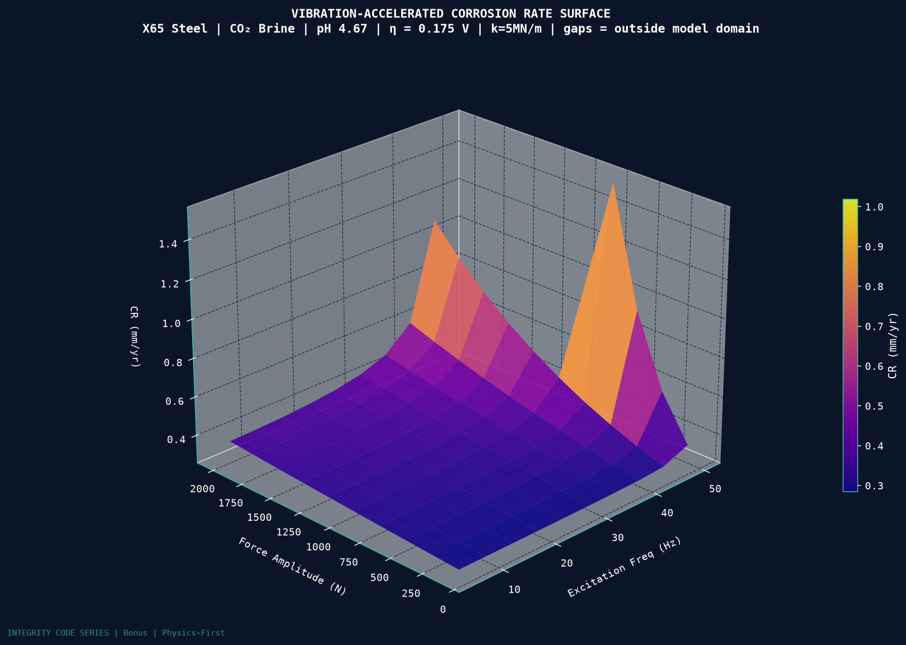

# INTEGRITY CODE SERIES - Bonus
## Vibration-Accelerated Corrosion: Coupled Mechano-Electrochemical Simulation

[](https://github.com/felipearocha/Vibration-Accelerated-Corrosion-Coupled-Mechano-Electrochemical-Simulation/actions/workflows/ci.yml)
[](https://doi.org/10.5281/zenodo.20172485)

---

## WHAT THIS IS

A physics-first engineering simulation of vibration-accelerated corrosion in X65 carbon steel pipe under CO2-saturated brine. The system couples:

- Damped single-degree-of-freedom structural vibration (SDOF)
- Stress-modified Butler-Volmer electrochemical kinetics
- Faraday mass loss rate (Corrosion)
- Archard fretting wear at pipe supports

An ML surrogate (GBR) is trained on the physics-generated sweep. All governing equations, boundary conditions, and assumptions are explicit in source code.

---

## KEY RESULTS



All numbers are model outputs, not measurements. See [EXPLICIT LIMITATIONS](#explicit-limitations).

| Result | Value |
|--------|-------|
| Default case, 15 Hz excitation, $f_n$ = 50.3 Hz | CR 0.222 mm/yr, static 0.207 mm/yr, VAF 1.07 |
| Sweep size | 50,000 rows, of which 49,400 inside the model domain |
| VAF inside the domain | 1.00 to 7.03, highest next to resonance |
| Strongest drivers of CR (Pearson, in-domain rows) | overpotential +0.45, pH −0.41 |
| GBR surrogate on the held-out 20% | R² 0.972, MAE 0.066 mm/yr, MAPE 57.8% |

Away from resonance vibration adds little in this model. The stress term only matters close to resonance.

---

## GOVERNING PHYSICS

### 1. SDOF Vibration

```math
m\ddot{x} + c\dot{x} + kx = F_0\sin(\omega t), \qquad c = 2\zeta\sqrt{km}, \qquad x(0) = \dot{x}(0) = 0
```

The sweep uses the closed-form steady-state amplitude:

```math
x_\mathrm{ss} = \frac{F_0/k}{\sqrt{(1-r^2)^2 + (2\zeta r)^2}}, \qquad r = \frac{\omega}{\omega_n}, \qquad \omega_n = \sqrt{k/m}
```

Symbols: $m$ mass [kg]; $c$ damping [N·s/m]; $k$ stiffness [N/m]; $x$ displacement [m]; $F_0$ force amplitude [N]; $\omega$ excitation frequency [rad/s]; $\zeta$ damping ratio.

### 2. Surface Stress

```math
\sigma = \frac{k\,\lvert x\rvert}{A_c}, \qquad \sigma_\mathrm{rms} = \frac{k\,x_\mathrm{ss}}{\sqrt{2}\,A_c}
```

Symbols: $\sigma$ surface stress [Pa]; $A_c$ contact area [m²].

### 3. Stress-Modified Butler-Volmer (anodic Tafel branch)

```math
i_\mathrm{0,eff} = i_\mathrm{0,ref}\exp\left(\frac{\beta\,\sigma}{RT}\right), \qquad i_a = i_\mathrm{0,eff}\,10^{\,\eta/b_a}
```

```math
\eta = \eta_0 - 0.0592\,(\mathrm{pH} - 4.5)
```

Symbols: $i_a$ anodic current density [A/cm²]; $i_\mathrm{0,ref}=10^{-6}$ A/cm² exchange current density at zero stress; $\beta=5\times10^{-5}$ m³/mol stress coefficient; $R$ gas constant; $T$ temperature [K]; $\eta$ anodic overpotential [V]; $\eta_0$ overpotential at pH 4.5 [V]; $b_a=0.12$ V/decade anodic Tafel slope.

### 4. Faraday Mass Loss

```math
\dot{m} = \frac{i\,M}{n\,F}, \qquad \mathrm{CR} = \frac{\dot{m}}{\rho}\times 10 \times 3.156\times10^{7}
```

Symbols: $\dot{m}$ mass loss rate [g/(cm²·s)]; $i$ current density [A/cm²]; $M$ atomic weight [g/mol]; $n=2$ electrons; $F$ Faraday constant [C/mol]; $\rho$ density [g/cm³]; $\mathrm{CR}$ corrosion rate [mm/yr].

### 5. Archard Fretting Wear

```math
V_\mathrm{wear} = K_\mathrm{wear}\,W\,s\,N, \qquad h = \frac{V_\mathrm{wear}}{A_c}
```

Symbols: $K_\mathrm{wear}$ wear coefficient [m²/N]; $W$ normal force [N]; $s$ slip amplitude [m]; $N$ cycles; $h$ thickness loss [m].

### 6. Sweep Outputs

```math
\mathrm{VAF} = \frac{\mathrm{CR}(\sigma_\mathrm{rms})}{\mathrm{CR}(0)}, \qquad \mathrm{CR}_\mathrm{total} = \mathrm{CR}(\sigma_\mathrm{rms}) + \frac{h}{N}\,f
```

Symbols: $\mathrm{VAF}$ vibration amplification factor; $f$ excitation frequency, with the fretting term converted to mm/yr.

---

## EXECUTION ORDER

```bash
# 1. Install dependencies
pip install -r requirements.txt

# 2. Run full pipeline (tests -> simulation -> sweep -> ML -> validation -> visuals)
python run_all.py                 # same as python run_pipeline.py

# 3. OR run steps individually:
python -m pytest tests/ -q        # 31 tests
python src/simulation/vibrocorrosion_engine.py
python src/simulation/parametric_sweep.py
python src/ml/gbr_surrogate.py
python src/validation/validation_suite.py
python src/visualization/viz_suite.py
python src/cybersecurity/sensor_security.py

# 4. Skip slow steps if assets already exist:
python run_pipeline.py --skip-tests --skip-sweep --skip-ml
```

Full pipeline: about 40-70 s measured on a laptop (Windows 11, Python 3.13). Hardware-dependent.

---

## REPOSITORY STRUCTURE

```
├── run_pipeline.py              # Master orchestrator (start here)
├── run_all.py                   # Same as run_pipeline.py
├── requirements.txt
├── README.md
├── src/
│   ├── simulation/
│   │   ├── vibrocorrosion_engine.py    # Core physics engine
│   │   └── parametric_sweep.py        # 50,000-point dataset generator
│   ├── ml/
│   │   └── gbr_surrogate.py           # ML surrogate training and prediction
│   ├── validation/
│   │   └── validation_suite.py        # Physics consistency checks
│   ├── visualization/
│   │   └── viz_suite.py               # All visuals + GIF
│   └── cybersecurity/
│       └── sensor_security.py         # Threat model + sensor integrity
├── tests/
│   └── test_all.py                    # Unit test suite
└── assets/                            # Generated outputs (tracked, regenerated by the pipeline)
    ├── parametric_sweep.csv
    ├── models/
    │   ├── gbr_model.pkl
    │   ├── scaler.pkl
    │   └── X_test.npy, y_test.npy, y_pred_test.npy
    ├── hero_3d_cr_surface.png
    ├── secondary_time_domain.png
    ├── secondary_residuals.png
    ├── secondary_isorisk_map.png
    ├── secondary_sensitivity.png
    ├── vibrocorrosion_sweep.gif
    └── validation_report.json
```

---

## OUTPUT FILE NAMING CONVENTIONS

| File | Description |
|------|-------------|
| `assets/parametric_sweep.csv` | 50,000-row physics dataset, with an `in_domain` flag |
| `assets/models/gbr_model.pkl` | Trained GBR model |
| `assets/models/scaler.pkl` | Feature scaler |
| `assets/hero_3d_cr_surface.png` | Primary hero visualization |
| `assets/secondary_*.png` | Secondary analysis charts |
| `assets/vibrocorrosion_sweep.gif` | Animated resonance sweep |
| `assets/validation_report.json` | Validation check results |
| `assets/audit_log.jsonl` | Hash-chained audit log (written only by `sensor_security.py`, not tracked) |

---

## EXPLICIT LIMITATIONS

1. `beta_stress` (stress coefficient) is an unsourced, phenomenological assumption. Calibration against coupon tests required before production use.
2. Model domain: results apply up to an RMS surface stress of 100 MPa. This limit is `[ASSUMED]`: it keeps the uncalibrated exponential stress term below about 7.5x. The 600 sweep rows above it are flagged `in_domain = 0` and excluded from the surrogate, the sensitivity chart and the maps.
3. Fretting-corrosion synergy term is NOT modeled, so total material loss may be underestimated.
4. Fretting uses a fixed slip amplitude, so it follows frequency but not vibration amplitude. `K_wear` is an approximate value without a cited source.
5. No external experimental dataset was used for validation. Internal consistency only.
6. Only the anodic branch is modeled: overpotential is an input, with no mixed-potential solution, cathodic kinetics or protective film.
7. pH acts only through a Nernst shift of the overpotential, taken at the full 59.2 mV per pH unit, which is an upper bound on how far the corrosion potential moves.
8. Stress model assumes spring-force / contact-area approximation. FEA required for real geometry.
9. The GBR surrogate is a demonstration, not deployment-ready. Its MAPE of 57.8% reflects large relative errors at low corrosion rates, and `predict()` does not check that inputs are inside the training domain.

---

## CYBERSECURITY ARCHITECTURE

Threats addressed: sensor spoofing, ML model tampering, data poisoning, audit log deletion, pipeline DoS.  
See `src/cybersecurity/sensor_security.py` for full threat model and mitigation code.  
Production deployment requires IEC 62443 zone/conduit model and HSM for model hash storage.

---

## STANDARDS REFERENCED (without specific clause citation)

- API 571: Damage Mechanisms Affecting Fixed Equipment (mechanical fatigue, including vibration-induced fatigue)
- API 580/581: Risk-Based Inspection methodology (probability of failure framework)
- IEC 62443: Industrial Automation and Control Systems cybersecurity

**NOTE:** No specific clause numbers are cited as these require license access for verification.

---

## REPRODUCIBILITY

Fixed seeds: `random_state=42` in all sklearn calls.  
ODE solver: SciPy RK45 with `rtol=1e-8, atol=1e-10`.  
All parameters defined in `MaterialParams`, `EnvironmentParams`, `VibrationParams` dataclasses.  
Sweep grid explicitly defined in `parametric_sweep.py`.

---

## How to Cite

If this software contributes to your work, please cite both the software (this repository) and the underlying methods it implements.

**Software (archived release):**

> Rocha, F. (2026). *Vibration-Accelerated Corrosion: Coupled Mechano-Electrochemical Simulation (Integrity Code Series Bonus)* (Version 0.1.1) [Computer software]. Zenodo. https://doi.org/10.5281/zenodo.20172485

**BibTeX:**

```bibtex
@software{rocha_2026_vibration,
  author       = {Rocha, Felipe},
  title        = {{Vibration-Accelerated Corrosion: Coupled Mechano-Electrochemical Simulation (Integrity Code Series Bonus)}},
  year         = 2026,
  publisher    = {Zenodo},
  version      = {v0.1.1},
  doi          = {10.5281/zenodo.20172485},
  url          = {https://doi.org/10.5281/zenodo.20172485}
}
```

The two DOIs Zenodo provides are:

| DOI                                  | What it points to                                                  |
|--------------------------------------|--------------------------------------------------------------------|
| `10.5281/zenodo.20172485` (concept)   | Always resolves to the latest version - use this for citation.     |
| `10.5281/zenodo.20172486` (version)   | Pinned to v0.1.1 specifically - use when reproducibility matters. The archived v0.1.1 predates the fixes listed under Unreleased in the [CHANGELOG](CHANGELOG.md). |

A machine-readable citation file is also available in [`CITATION.cff`](CITATION.cff) - GitHub will display a "Cite this repository" widget at the top right of the repo page that exports BibTeX / APA / RIS automatically.

---

## Integrity Code Series

Part of an ongoing series of physics-first integrity simulators by Felipe Rocha:

| # | Repo | Domain |
|---|---|---|
| Week 3 | [integrity-code-series-week3-f1-lap-simulation](https://github.com/felipearocha/integrity-code-series-week3-f1-lap-simulation) | F1 lap simulation (six-state model) |
| Week 6 | [integrity-code-series-week6-smartphone-galvanic](https://github.com/felipearocha/integrity-code-series-week6-smartphone-galvanic) | Smartphone galvanic corrosion (Laplace + Butler-Volmer) |
| Week 7 | [integrity-code-series-week7-h2-lferw](https://github.com/felipearocha/integrity-code-series-week7-h2-lferw) | LF-ERW H2 conversion (B31.12 + NACE TM0316) |
| Week 8 | [integrity-code-series-week8-creep-fatigue-heater](https://github.com/felipearocha/integrity-code-series-week8-creep-fatigue-heater) | Creep-fatigue 9Cr-1Mo (Norton/Omega + Coffin-Manson) |
| Week 9 | [integrity-code-series-week9-cui](https://github.com/felipearocha/integrity-code-series-week9-cui) | CUI thermohygro-electrochemical (2 PDEs + Butler-Volmer, Strang) |
| Week 10 | [integrity-code-series-week10-nnph-scc](https://github.com/felipearocha/integrity-code-series-week10-nnph-scc) | NNpHSCC full-physics (Chen-Sutherby-Xing + BS 7910) |
| Week 11 | [integrity-code-series-week11-erosion-corrosion-multiphase](https://github.com/felipearocha/integrity-code-series-week11-erosion-corrosion-multiphase) | Erosion-corrosion multiphase (NORSOK M-506 + DNV-RP-O501 + G119 + API 579) |
| Bonus | [Vibration-Accelerated-Corrosion-Coupled-Mechano-Electrochemical-Simulation](https://github.com/felipearocha/Vibration-Accelerated-Corrosion-Coupled-Mechano-Electrochemical-Simulation) | Vibration-accelerated corrosion (SDOF + Butler-Volmer + Archard) |
| Bonus | [synthetic-integrity-digital-twin-piml](https://github.com/felipearocha/synthetic-integrity-digital-twin-piml) | Physics-informed neural-network surrogate |
| Bonus | [integrity-data-foundation](https://github.com/felipearocha/integrity-data-foundation) | Engineering data validation baseline |

*INTEGRITY CODE SERIES | Physics-First Engineering | Bonus*  
*Verification over visibility. Safety over novelty.*
